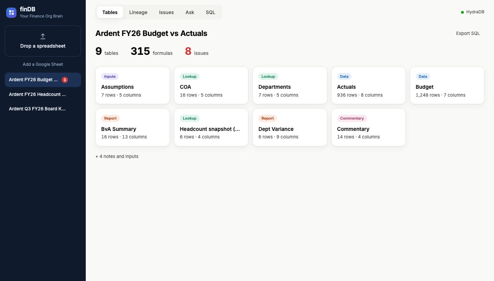
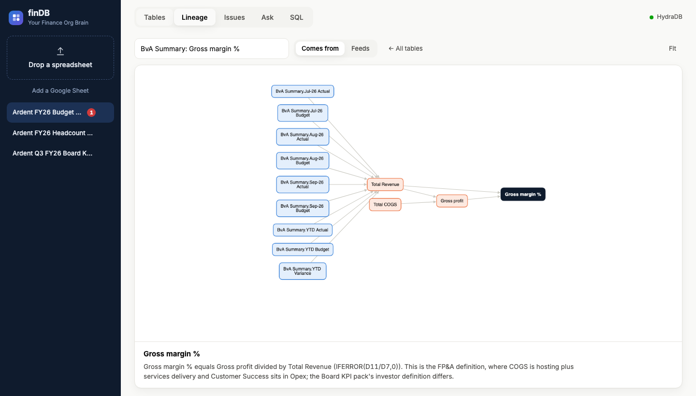
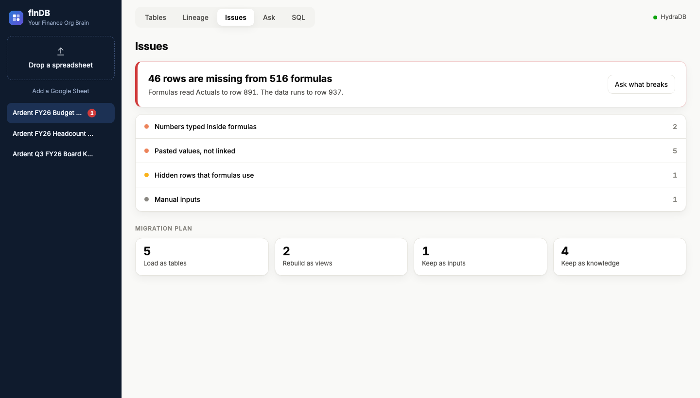

# finDB

**Your Finance Org Brain.** Finance knowledge lives in spreadsheets. Databases keep the numbers and lose the story. finDB keeps both: drop a file and get tables, formula lineage and analyst notes in a HydraDB brain.

Built solo at the Company Brain Hackathon (TechEquity Ai, Snowflake Silicon Valley AI Hub, October 12 2026).





## What it does

Drop an Excel workbook, or paste a link to a shared Google Sheet, and finDB:

- **Finds the tables**, including several on one sheet, hidden helper rows, totals and blocks of manual inputs.
- **Builds the schema**: column types, keys and relationships, within a workbook and across workbooks.
- **Traces every formula** into lineage you can click through, number by number.
- **Flags what is fragile**: ranges that stop short of the data, pasted values, numbers typed inside formulas, manual inputs.
- **Keeps the context**: cell comments, commentary, change logs and metric definitions.
- **Answers questions** in plain English with cited sources, and remembers what analysts teach it.
- **Migrates**: SQL DDL for every table, all rows queryable in SQL.

HydraDB is the brain (catalog, lineage graph, rows, notes and memory). SQL is the muscle (DuckDB mirror with generated DDL).

## Run it

Requires [uv](https://docs.astral.sh/uv/). Both API keys are optional: without a HydraDB key it uses a local store, and without an Anthropic key the Ask tab returns the retrieved context instead of a written answer.

```bash
cd finance-brain
cp .env.example .env        # add ANTHROPIC_API_KEY and HYDRA_DB_API_KEY, set FB_STORE=hydradb to use HydraDB
uv run uvicorn finance_brain.app:app --host 127.0.0.1 --port 8765
open http://127.0.0.1:8765
```

Then drag a workbook from `samples/` onto the sidebar. Tests: `uv run pytest -q`.

## What is here

| Path | What |
|---|---|
| `finance-brain/` | The app: capture engine, HydraDB and local stores, DuckDB mirror, Claude answers, single-page UI. See its [README](finance-brain/README.md) for the design and a demo script. |
| `samples/` | Three workbooks for a fictional SaaS company, Ardent Labs, with planted errors, plus the script that generates them. |
| `DEVPOST.md` | The hackathon write-up. |

Built with HydraDB, Python, FastAPI, openpyxl, DuckDB, Claude and Cytoscape.
